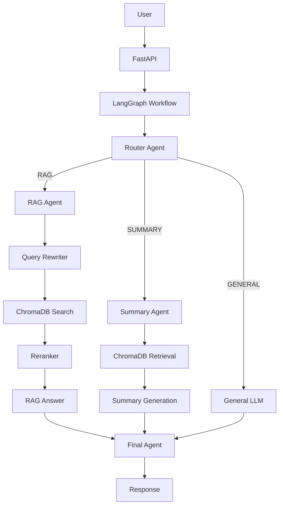

# AI Study Assistant

An AI-powered study assistant that lets users upload study material (PDF, TXT, Markdown) and interact with it through intelligent Q&A. Built with **Python**, **FastAPI**, **LangChain**, **LangGraph**, and **ChromaDB**.

## Features

- **Document Upload** — Upload PDF, TXT, and Markdown study material
- **RAG Pipeline** — Retrieve relevant chunks from uploaded material to generate grounded answers
- **Multi-Agent Architecture** — Router, RAG, Summary, and Final agents orchestrated by LangGraph
- **Query Rewriting** — Handles follow-up questions by resolving context from conversation history
- **Reranking** — LLM-based reranking to surface the most relevant chunks
- **Conversation Memory** — SQLite-backed conversation history for contextual interactions
- **Document Isolation** — Users can only access their own documents
- **Structured Routing** — LLM structured output for reliable query classification
- **Error Handling** — Retries, fallbacks, and graceful error responses

---

## Architecture



---

## LangGraph Workflow

```mermaid
flowchart TD
    START([START]) --> LoadContext[Load Conversation Context]
    LoadContext --> RouteQuery[Route Query]
    RouteQuery -->|RAG| RewriteQuery[Rewrite Query]
    RouteQuery -->|SUMMARY| SummaryRetrieve[Retrieve Summary Docs]
    RouteQuery -->|GENERAL| GeneralAnswer[General LLM Answer]
    RewriteQuery --> RetrieveDocs[ChromaDB Search]
    RetrieveDocs --> RerankDocs[Rerank Documents]
    RerankDocs --> RAGAnswer[Generate RAG Answer]
    RAGAnswer --> FinalAnswer[Final Agent]
    SummaryRetrieve --> SummaryGenerate[Generate Summary]
    SummaryGenerate --> FinalAnswer
    GeneralAnswer --> FinalAnswer
    FinalAnswer --> END([END])
```



### Workflow Nodes

| Node | Description |
|------|-------------|
| **Load Context** | Loads recent conversation history from SQLite |
| **Route Query** | Classifies the question as RAG, SUMMARY, or GENERAL using structured output |
| **Rewrite Query** | Resolves follow-up references using conversation context |
| **Retrieve Documents** | Searches ChromaDB with user_id filtering |
| **Rerank Documents** | LLM-based relevance scoring, returns top K chunks |
| **RAG Answer** | Generates a grounded answer from retrieved context |
| **Summary Retrieve** | Retrieves all chunks for a specific document |
| **Summary Generate** | Creates a structured summary |
| **General Answer** | Direct LLM response for non-document questions |
| **Final Answer** | Polishes the response for presentation |

---

## RAG Pipeline

```
Document Upload → Text Extraction → Chunking → Embedding → ChromaDB
                                                              ↓
Question → Query Rewrite → Similarity Search → Reranking → LLM → Answer
```

1. **Ingestion**: Documents are parsed (PyPDFLoader for PDFs, plain read for TXT/MD), split into chunks (800 chars, 120 overlap), embedded, and stored in ChromaDB with metadata.
2. **Retrieval**: Similarity search with `user_id` filtering returns top-K candidates.
3. **Reranking**: LLM scores each chunk's relevance (0-10), returning the best results.
4. **Generation**: The LLM generates a grounded answer citing the retrieved sources.

---

## Multi-Agent Architecture

| Agent | Purpose |
|-------|---------|
| **Router Agent** | Classifies queries into RAG/SUMMARY/GENERAL using structured output |
| **RAG Agent** | Generates answers grounded in retrieved study material |
| **Summary Agent** | Creates structured summaries of uploaded documents |
| **Final Agent** | Polishes and formats the final response |

General questions go directly to the LLM (no separate agent needed).

---

## Conversation Memory

- Conversations and messages are stored in **SQLite** via SQLAlchemy
- Recent messages (configurable, default 10) are loaded as context
- History is used by the Router, Query Rewriter, and Final Agent
- Follow-up questions are resolved using conversation context

---

## API Documentation

| Method | Endpoint | Description |
|--------|----------|-------------|
| `GET` | `/health` | Health check |
| `POST` | `/api/documents/upload` | Upload a study document (PDF/TXT/MD) |
| `GET` | `/api/documents/` | List user's documents |
| `DELETE` | `/api/documents/{document_id}` | Delete a document and its vectors |
| `POST` | `/api/chat` | Ask a question (routes through LangGraph) |
| `POST` | `/api/summarize` | Summarize a specific document |

### Headers

All endpoints accept `X-User-ID` header (defaults to `default_user`).

### Chat Request/Response

```json
// POST /api/chat
// Request
{
  "conversation_id": "optional-uuid",
  "question": "What is polymorphism?"
}

// Response
{
  "conversation_id": "uuid",
  "answer": "Polymorphism allows...",
  "route": "RAG",
  "sources": [
    {"document": "JavaNotes.pdf", "page": 25, "chunk_id": "abc123"}
  ]
}
```

### Summarize Request/Response

```json
// POST /api/summarize
// Request
{"document_id": "uuid"}

// Response
{"document_id": "uuid", "summary": "This document covers..."}
```

---

## Setup

```bash
# Clone the repository
git clone <repository-url>
cd study-assistant

# Create virtual environment
python -m venv .venv

# Activate (Windows)
.venv\Scripts\activate

# Activate (Linux/Mac)
source .venv/bin/activate

# Install dependencies
pip install -r requirements.txt

# Configure environment
cp .env.example .env
# Edit .env with your OpenAI API key
```

---

## Environment Variables

| Variable | Default | Description |
|----------|---------|-------------|
| `LLM_API_KEY` | _(required)_ | OpenAI API key |
| `LLM_MODEL` | `gpt-4o-mini` | LLM model name |
| `LLM_BASE_URL` | _(none)_ | Custom API base URL (for compatible providers) |
| `EMBEDDING_MODEL` | `text-embedding-3-small` | Embedding model name |
| `CHROMA_PERSIST_DIR` | `./data/chroma` | ChromaDB storage directory |
| `RAG_CHUNK_SIZE` | `800` | Document chunk size in characters |
| `RAG_CHUNK_OVERLAP` | `120` | Overlap between chunks |
| `RAG_TOP_K` | `10` | Number of chunks to retrieve |
| `RAG_FINAL_K` | `5` | Number of chunks after reranking |
| `MAX_CONVERSATION_HISTORY` | `10` | Messages to include in context |
| `MAX_FILE_SIZE_MB` | `10` | Maximum upload file size |
| `DATABASE_URL` | `sqlite:///./data/study_assistant.db` | Database connection string |

---

## Running

```bash
uvicorn app.main:app --reload
```

API docs available at: `http://localhost:8000/docs`

---

## Testing

```bash
pytest tests/ -v
```

Tests mock all LLM calls — no API key needed to run them.

---

## Example Usage

```bash
# Upload a document
curl -X POST http://localhost:8000/api/documents/upload \
  -H "X-User-ID: student1" \
  -F "file=@JavaNotes.pdf"

# List documents
curl http://localhost:8000/api/documents/ -H "X-User-ID: student1"

# Ask a RAG question
curl -X POST http://localhost:8000/api/chat \
  -H "Content-Type: application/json" \
  -H "X-User-ID: student1" \
  -d '{"question": "What is polymorphism?"}'

# Follow-up question (same conversation)
curl -X POST http://localhost:8000/api/chat \
  -H "Content-Type: application/json" \
  -H "X-User-ID: student1" \
  -d '{"conversation_id": "<id-from-previous>", "question": "Give me a Java example"}'

# General question (no RAG)
curl -X POST http://localhost:8000/api/chat \
  -H "Content-Type: application/json" \
  -H "X-User-ID: student1" \
  -d '{"question": "What is the capital of France?"}'

# Summarize a document
curl -X POST http://localhost:8000/api/summarize \
  -H "Content-Type: application/json" \
  -H "X-User-ID: student1" \
  -d '{"document_id": "<document-id>"}'

# Delete a document
curl -X DELETE http://localhost:8000/api/documents/<document-id> \
  -H "X-User-ID: student1"
```

---

## Project Structure

```
study-assistant/
├── app/
│   ├── main.py                    # FastAPI application
│   ├── api/
│   │   ├── chat.py                # POST /api/chat
│   │   ├── documents.py           # Document CRUD endpoints
│   │   └── summary.py             # POST /api/summarize
│   ├── agents/
│   │   ├── router_agent.py        # Query classification
│   │   ├── rag_agent.py           # Grounded answer generation
│   │   ├── summary_agent.py       # Document summarization
│   │   └── final_agent.py         # Response polishing
│   ├── graph/
│   │   ├── state.py               # StudyAssistantState TypedDict
│   │   ├── workflow.py            # LangGraph StateGraph
│   │   └── nodes/                 # Individual graph nodes
│   ├── rag/
│   │   ├── ingestion.py           # Document parsing & embedding
│   │   ├── retrieval.py           # ChromaDB search
│   │   ├── query_rewriter.py      # Contextual query rewriting
│   │   └── reranker.py            # LLM-based reranking
│   ├── database/
│   │   ├── database.py            # SQLite engine & session
│   │   ├── models.py              # ORM models
│   │   └── repositories.py        # DB query functions
│   ├── llm/
│   │   └── llm.py                 # LLM & embeddings factory
│   ├── prompts/                   # Prompt templates
│   └── core/
│       ├── config.py              # Pydantic settings
│       └── exceptions.py          # Custom exceptions
├── tests/
│   ├── conftest.py                # Shared fixtures
│   ├── test_router.py
│   ├── test_rag.py
│   ├── test_query_rewriter.py
│   ├── test_workflow.py
│   └── test_api.py
├── data/
│   └── chroma/                    # ChromaDB persistence
├── requirements.txt
├── .env.example
└── .gitignore
```

---

## Explain This Project in 2 Minutes

> "I built an AI Study Assistant using Python, FastAPI, LangChain, LangGraph, and ChromaDB. Users upload study material — PDFs, text files, or markdown — which gets chunked, embedded, and stored in ChromaDB as vectors.
>
> When a user asks a question, it flows through a LangGraph StateGraph workflow. First, a Router Agent classifies the query using structured LLM output into three paths: RAG for document questions, Summary for summarization requests, and General for unrelated questions.
>
> The RAG path rewrites follow-up questions using conversation history, searches ChromaDB with user-scoped metadata filtering, reranks the results using an LLM-based scorer, and generates a grounded answer with source citations. The Summary path retrieves all chunks for a document and produces a structured summary. General questions skip retrieval entirely — an important optimization.
>
> Conversation history is stored in SQLite, enabling contextual follow-ups. The architecture is simple: FastAPI handles HTTP, LangGraph orchestrates the workflow as a state machine with conditional routing, and LangChain provides the LLM and retrieval abstractions. Everything is tested with mocked LLM calls."

---

## Interview Q&A

**1. Why LangGraph over plain LangChain?**
LangGraph provides a StateGraph abstraction for orchestrating complex multi-step workflows with conditional routing, shared state, and clear node boundaries. Plain LangChain chains are linear; LangGraph handles branching (RAG vs Summary vs General) naturally.

**2. How does the Router Agent work?**
It uses `llm.with_structured_output(RouteDecision)` to classify queries into RAG, SUMMARY, or GENERAL. Structured output guarantees a valid Pydantic model instead of unreliable string parsing. On failure, it defaults to GENERAL.

**3. Explain the RAG pipeline.**
Documents are chunked (800 chars, 120 overlap), embedded via OpenAI, and stored in ChromaDB. At query time: rewrite the query → similarity search with user filtering → LLM-based reranking → generate a grounded answer with source citations.

**4. How does query rewriting help?**
Follow-up questions like "Give me a Java example" after discussing polymorphism lack context. The rewriter uses conversation history to produce "Give me a Java example of polymorphism" — a standalone query that retrieves relevant chunks.

**5. What is reranking and why use it?**
Retrieve a larger candidate set (top 10) then use an LLM to score each chunk's relevance. Only the best 5 go to the answer generator. This improves answer quality by filtering out marginally relevant chunks.

**6. How is document isolation achieved?**
Every chunk in ChromaDB includes `user_id` metadata. Retrieval uses `filter={"user_id": current_user}` so User A never sees User B's documents.

**7. How is conversation context maintained?**
Messages are stored in SQLite (conversations + messages tables). The last N messages are loaded at workflow start and passed to the Router, Query Rewriter, and answer generators.

**8. What happens if the LLM fails?**
The LLM client has `max_retries=3`. The Router falls back to GENERAL. The Query Rewriter returns the original question. The Reranker returns unranked documents. The Final Agent returns the draft answer. Errors return clear HTTP responses.

**9. How does ChromaDB store embeddings?**
ChromaDB persists to `./data/chroma`. Each document chunk is stored as: vector embedding + page_content + metadata (user_id, document_id, filename, page_number, chunk_id). LangChain's Chroma integration handles the embedding and storage.

**10. Why structured output for routing?**
`with_structured_output()` uses the LLM's function-calling API to guarantee a valid `RouteDecision` Pydantic model. This eliminates brittle string parsing like `if "RAG" in response`.

**11. How would you scale this?**
Replace SQLite with PostgreSQL, add user authentication (JWT), deploy with Gunicorn workers, use a hosted ChromaDB or Pinecone for vector storage, add async LLM calls, and implement response streaming.

**12. What are the performance optimizations?**
General questions skip RAG retrieval entirely. Only recent conversation history is loaded. A larger candidate set is retrieved then reranked down. Query rewriting is skipped for standalone questions.

**13. How do you test without a real LLM?**
All LLM calls are mocked using `unittest.mock.patch`. Tests verify routing logic, pipeline flow, API responses, and error handling without any API key or network calls.

**14. What is the StateGraph pattern?**
LangGraph's StateGraph is a state machine where nodes are functions that receive and update shared state (a TypedDict). Edges define transitions, and conditional edges enable branching based on state values.

**15. How do conditional edges work?**
After the Router node sets `state["route"]`, a decision function maps the route value to the next node name. LangGraph uses this mapping to route execution to the correct path (RAG, Summary, or General).
